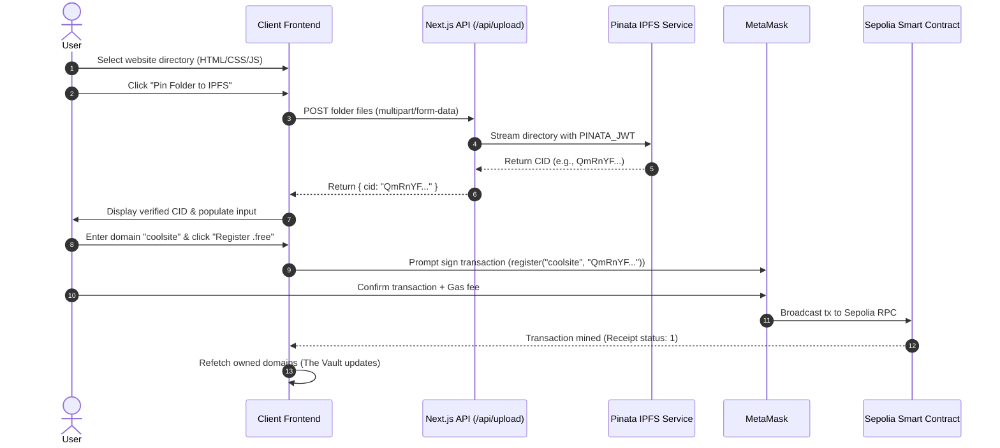
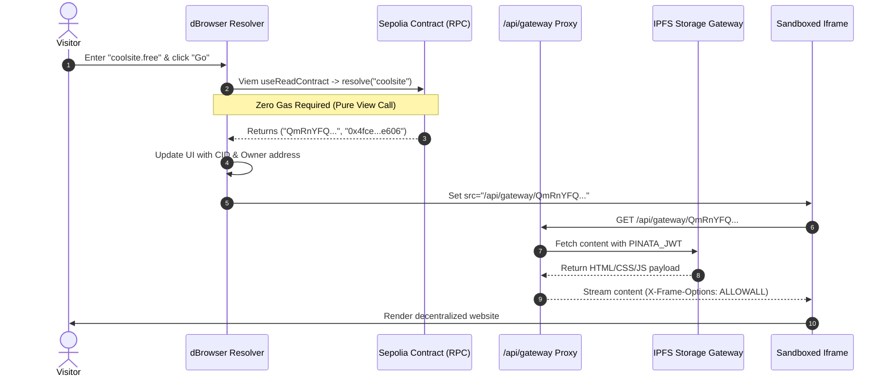

# Free-Net dHost: Comprehensive Presentation & Technical Defense Guide

This guide is designed for presenting and defending **Free-Net dHost** before evaluators, professors, and technical audiences. It covers the core motivation, deep-dive tech stack analysis, component walkthroughs, architecture diagrams, live demonstration script, and anticipated viva questions.

---

## 1. Executive Summary & Problem Statement

### 1.1 The Problem with Centralized Web (Web2)
| Vulnerability | Centralized Web (Web2) | Free-Net dHost Solution (Web3) |
|---|---|---|
| **Single Point of Failure** | Centralized hosting providers (AWS, Azure, Vercel) can experience server outages, taking websites offline. | **IPFS Peer-to-Peer Network**: Files are content-addressed and hosted across distributed nodes globally. |
| **Domain Censorship & Seizure** | Centralized registrars (ICANN, GoDaddy) can arbitrarily revoke, seize, or suspend domain names. | **Ethereum Smart Contract Registry**: Domains are cryptographically bound to public keys; only the private key holder can modify them. |
| **Data Tampering** | Content on HTTP servers can be silently modified or corrupted without users' knowledge. | **Cryptographic Content Addressing (CID)**: If even 1 byte changes, the cryptographic hash changes, guaranteeing immutability. |
| **Location vs Content Addressing** | URLs point to physical IP addresses (`http://192.0.2.1/page`). If the IP changes or server dies, links break (Error 404). | **Content Addressing**: URLs point to the hash of the data itself (`ipfs://Qm...`), agnostic to which node serves it. |

---

## 2. Complete Technology Stack Deep Dive

### 2.1 State & Ownership Layer (Blockchain)
* **Solidity (`^0.8.20`)**:
  * *Why chosen*: The industry-standard smart contract programming language for Ethereum Virtual Machine (EVM). Version `0.8.20` provides built-in overflow/underflow protection and efficient bytecode generation.
  * *Role*: Implements the core state machine [`DomainRegistry.sol`](file:///C:/Users/arpit/Desktop/blockchain/freenet-contracts/src/DomainRegistry.sol), mapping human-readable names (`.free`) to IPFS hashes and owner wallet addresses.
* **Foundry (Forge, Cast, Anvil)**:
  * *Why chosen*: A blazing-fast, Rust-native Ethereum development toolkit. Unlike Hardhat, Foundry allows writing tests directly in Solidity without JavaScript impedance mismatch, providing instant compilation and sub-second test execution.
  * *Components*:
    * `forge`: Compiles contracts and executes unit tests.
    * `cast`: CLI for sending transactions and making zero-gas read calls directly to RPC nodes.
    * `anvil`: Local high-speed Ethereum test node for offline testing.
* **Ethereum Sepolia Testnet**:
  * *Why chosen*: The primary proof-of-stake testnet for Ethereum, exactly replicating Mainnet EVM execution rules without monetary risk.

---

### 2.2 Storage & Peer-to-Peer Layer (IPFS)
* **IPFS (InterPlanetary File System)**:
  * *Why chosen*: A peer-to-peer distributed hypermedia protocol designed to make the web faster, safer, and open. It eliminates location-based URLs and replaces them with cryptographic CIDs.
* **Content Identifier (CIDv0 / CIDv1)**:
  * *Role*: Cryptographic fingerprint of the uploaded directory generated by SHA-256 / multihash encoding. Any modification produces an entirely different CID.
* **Pinata Cloud SDK & API**:
  * *Why chosen*: Acts as a high-availability IPFS pinning service and dedicated gateway cluster, guaranteeing that uploaded files remain persistently accessible on the IPFS Distributed Hash Table (DHT) 24/7.

---

### 2.3 Client & Frontend Layer
* **Next.js (Pages Router, React 19)**:
  * *Why chosen*: Delivers fast server-side API routes combined with responsive client-side React rendering. Pages Router was selected to isolate Web3 client state and provide clean API route proxies.
* **Tailwind CSS (v4)**:
  * *Why chosen*: Utility-first styling framework enabling custom design tokens, rapid layout iteration, and zero CSS runtime overhead.
* **Art Deco ("The Grand Exchange") Aesthetic**:
  * *Why chosen*: Reflects the metaphorical elegance of a 1920s cryptographic trust institution: deep slate black (`#0A0A0A`), metallic gold accents (`#D4AF37`), champagne text (`#F2F0E4`), and geometric stepped borders.

---

### 2.4 Web3 Middleware & RPC Communication
* **Viem**:
  * *Why chosen*: A modern, modular, lightweight TypeScript interface for Ethereum. Provides type-safe contract ABI parsing, address validation (`isAddress`), and efficient JSON-RPC encoding.
* **Wagmi (v2)**:
  * *Why chosen*: React hooks library built on Viem. Manages wallet connection lifecycles, account switching, contract read states (`useReadContract`), transaction signing (`useWriteContract`), and on-chain confirmation receipts (`useWaitForTransactionReceipt`).
* **RainbowKit**:
  * *Why chosen*: The premier Web3 wallet modal library. Provides responsive UI for connecting MetaMask, WalletConnect, Coinbase Wallet, and hardware wallets, complete with chain-switching alerts and balance indicators.
* **TanStack React Query**:
  * *Why chosen*: Powers asynchronous state caching, automatic background refetching, and query synchronization for on-chain contract calls.

---

### 2.5 Backend Proxy Architecture
* **Formidable & Node.js Multipart Streaming**:
  * *Role*: Parses multi-file directory uploads on the server side (`/api/upload`) with zero client-side JWT exposure.
* **In-App Gateway Streaming Proxy (`/api/gateway/[...path]`)**:
  * *Why needed*: Public IPFS gateways block browser iframes via `X-Frame-Options: SAMEORIGIN` and rate limits (`429`). The custom Next.js gateway proxy fetches from Pinata's authorized cluster, strips restrictive headers, and streams the raw assets directly into the sandbox.

---

## 3. System Architecture & Data Flows

### 3.1 Overall System Diagram

```mermaid
flowchart TD
    subgraph Client ["Client Browser (Next.js)"]
        UI["Web3 UI (RainbowKit / Wagmi)"]
        FileSelect["Folder Selector (webkitdirectory)"]
        Sandbox["Sandboxed Iframe Viewer"]
    end

    subgraph Backend ["Next.js Server API"]
        UploadAPI["/api/upload Proxy"]
        GatewayAPI["/api/gateway Proxy"]
    end

    subgraph IPFS_Net ["IPFS Storage Network"]
        Pinata["Pinata Pinning Service"]
        IPFSDHT["Global IPFS DHT"]
    end

    subgraph Blockchain ["Ethereum Sepolia Testnet"]
        Contract["DomainRegistry.sol (0xD561cB...)"]
        Mapping["registry mapping (Name -> CID & Owner)"]
    end

    FileSelect -->|Multi-file Form Data| UploadAPI
    UploadAPI -->|Authorized Pinning + JWT| Pinata
    Pinata -->|Announces CID| IPFSDHT
    UploadAPI -->|Returns Immutable CID| UI

    UI -->|register(name, cid)| Contract
    Contract -->|Records on-chain| Mapping

    UI -->|resolve(name) - Zero Gas| Mapping
    Mapping -->|Returns CID & Owner| UI
    UI -->|Request /api/gateway/CID| GatewayAPI
    GatewayAPI -->|Authorized Stream| Pinata
    GatewayAPI -->|Render Website| Sandbox
```

---

### 3.2 Sequence Diagram: Deployment Flow (Write)



---

### 3.3 Sequence Diagram: Resolution Flow (Read)



---

## 4. Component-by-Component Walkthrough

### 4.1 Navigation & Global Chrome
* **Header**:
  * **Rotated Diamond Glyph**: Art Deco geometric visual anchor.
  * **Logo & Title**: "FREE·NET dHost" in Marcellus serif typography.
  * **Sepolia Testnet Indicator**: Shows current network state.
  * **RainbowKit `<ConnectButton />`**: Displays connected address (`0x4f...e606`), balance (`0.046 ETH`), and network switcher modal.
* **Network Warning Banner**:
  * Conditionally renders if the smart contract address is missing or invalid, guiding users to deploy.

---

### 4.2 Step I: Archive Documents (IPFS Folder Upload)
* **File Directory Input**:
  * Uses `{...({ webkitdirectory: '', directory: '' })}` to enable native folder selection in web browsers.
  * Shows real-time file count (`X files selected`).
* **Upload Trigger Button**:
  * Initiates client-side packaging: preserves internal paths (`webkitRelativePath`) so multi-file static projects (HTML, CSS, assets) maintain relative links.
* **Security & Reliability Proxy ([`pages/api/upload.ts`](file:///C:/Users/arpit/Desktop/blockchain/freenet-frontend/pages/api/upload.ts))**:
  * Enforces `bodyParser: false` for memory-efficient multi-part parsing with `formidable`.
  * Protects the `PINATA_JWT` on the server so private API keys are never leaked to client bundles.
  * Buffers binary chunks into an IPFS directory payload (`pinataMetadata`).
* **Verified CID Badge**:
  * Displays the generated cryptographic hash and auto-populates the registration form.

---

### 4.3 Step II: Register Domain (On-Chain Notarization)
* **Domain Input**:
  * Strips trailing `.free` extensions and sanitizes input.
* **Wagmi `useWriteContract`**:
  * Prepares ABI call `register(domainName, cid)`.
  * Prompts MetaMask for user signature and gas authorization.
* **Wagmi `useWaitForTransactionReceipt`**:
  * Tracks transaction lifecycle:
    * *Pending signature*: "Confirm in Wallet..."
    * *Mined on network*: "Notarizing on Sepolia..." (amber pulsing indicator)
    * *Confirmed*: "Deed notarized successfully on Sepolia!" (emerald indicator)
  * Error boundary automatically formats reverts (e.g. "Domain already taken") into readable alerts without crashing React.

---

### 4.4 Step III: The Vault (Owned Domains Dashboard)
* **Wagmi `useReadContract` with `getUserDomains(userAddress)`**:
  * Automatically reads the owner's active domains from the blockchain.
  * Re-executes dynamically via `useEffect` whenever a registration or update transaction succeeds.
* **Domain Card Actions**:
  * **"View"**: Automatically loads the domain into the resolver and triggers resolution.
  * **"Update CID"**: Prompts the user for a new IPFS hash and signs `updateCID(domain, newCid)`, enabling censorship-resistant content updates while preserving the permanent domain name.

---

### 4.5 Step IV: dBrowser Resolver & Isolated Sandbox
* **Zero-Gas Search**:
  * Queries `resolve(searchDomain)` without sending a transaction or spending ETH.
  * Displays verified IPFS hash and owner wallet address.
* **Streaming Gateway Proxy ([`pages/api/gateway/[...path].ts`](file:///C:/Users/arpit/Desktop/blockchain/freenet-frontend/pages/api/gateway/[...path].ts))**:
  * Solves public IPFS gateway restrictions (`X-Frame-Options: SAMEORIGIN` and 429 rate limits).
  * Automatically handles root folder listings and rewrites relative IPFS paths.
* **Isolated `<iframe>` Sandbox**:
  * Configured with `sandbox="allow-scripts allow-same-origin"` to isolate untrusted user-submitted website scripts from the main dApp session.
* **"Open in Tab ↗" Action**:
  * Provides instant single-click full-screen inspection.

---

## 5. Live Demonstration Script (Step-by-Step)

Follow this sequence during project demonstrations:

1. **Introduction (1 min)**:
   * *"Good morning. Today we present Free-Net dHost, a decentralized hosting and domain resolution infrastructure that replaces centralized cloud hosts and ICANN registries with Ethereum smart contracts and IPFS."*
2. **Show Wallet Authentication (30 sec)**:
   * Point to top right: Click **Connect Wallet**. Show MetaMask connecting on Ethereum Sepolia.
   * Highlight the live testnet balance (e.g., `0.046 SepoliaETH`).
3. **Upload Assets to IPFS (1 min)**:
   * Under **"I. Archive Documents"**, click **Choose Files** and select `sample-site` (or your project folder).
   * Click **"Pin Folder to IPFS via Pinata"**.
   * Highlight the generated CID: *"This cryptographic hash represents the immutable contents of our website. If a single line of code changes, this CID changes."*
4. **Register Custom `.free` Domain (1 min)**:
   * Enter a domain name (e.g., `coolsite`).
   * Click **"Register .free Domain"**.
   * Show MetaMask popup: *"MetaMask is signing an on-chain transaction invoking the register function on our smart contract deployed on Sepolia."*
   * Show the confirmation indicator: *"The deed is now immutably etched onto the Ethereum blockchain."*
5. **Demonstrate The Vault (30 sec)**:
   * Show `coolsite.free` appearing in **The Vault**.
   * Explain: *"Only our wallet address holds cryptographic ownership. We can update the content hash at any time, but nobody can confiscate our address."*
6. **Demonstrate Domain Resolution (1 min)**:
   * Go to **dBrowser Directory Board**. Type `coolsite` and click **Go**.
   * Show the resolution: *"The resolver executed a zero-gas read call against the smart contract, mapped coolsite to our IPFS hash, and rendered the site inside our isolated sandbox frame."*
   * Show the rendered page running inside the browser.

---

## 6. Comprehensive Defense & Viva Q&A

### Q1: Why use IPFS instead of storing HTML files directly on Ethereum?
> **Answer**: Storing raw data directly in Ethereum contract storage is cost-prohibitive. Storing 1 MB of data on Ethereum mainnet would cost thousands of dollars in gas fees due to global state replication across every node. Ethereum is optimized for **state and verification**, whereas IPFS is optimized for **large distributed file storage**. Free-Net dHost uses a hybrid architecture: the lightweight cryptographic hash (CID, ~46 bytes) is stored on-chain, while the heavy web assets are stored on IPFS.

---

### Q2: What prevents someone else from hijacking or updating my domain?
> **Answer**: Ownership is enforced at the bytecode level by Solidity's `onlyOwner` modifier:
> ```solidity
> modifier onlyOwner(string memory _name) {
>     require(registry[_name].owner == msg.sender, "Not domain owner");
>     _;
> }
> ```
> When `updateCID` is called, the EVM cryptographically verifies the transaction signature against `msg.sender`. If any other address attempts to modify the domain, the EVM reverts the transaction.

---

### Q3: How does resolution achieve "zero gas"?
> **Answer**: In EVM architecture, functions marked with the `view` keyword (such as `resolve` and `getUserDomains`) only read blockchain state without altering it. Because no state transitions occur, no consensus or miner computation is required. Viem and RPC nodes execute this read call locally on their copy of the state, resulting in instantaneous, zero-cost queries.

---

### Q4: Why is an in-app gateway proxy necessary instead of embedding public IPFS gateways directly?
> **Answer**: Public gateways like `ipfs.io` and `dweb.link` enforce `X-Frame-Options: SAMEORIGIN` and Cloudflare Turnstile anti-bot checks to prevent clickjacking. If an application attempts to embed them directly in an `<iframe>` on localhost or a custom domain, modern browsers block the connection. Our Next.js proxy fetches content via authorized server-side channels, strips restrictive framing headers, and streams the verified content directly into the sandbox.

---

### Q5: Why is the sandboxed iframe configured with `sandbox="allow-scripts allow-same-origin"`?
> **Answer**: Websites hosted on the decentralized web may contain arbitrary third-party JavaScript. If rendered directly in the parent DOM, a malicious site could access `window.localStorage`, manipulate the parent application's Web3 wallet connection, or spoof user actions. The sandboxed iframe creates an isolated browsing context that protects the host application from malicious script injection.

---

### Q6: What happens if a domain name is already registered?
> **Answer**: The contract enforces uniqueness in the `register` function:
> ```solidity
> require(registry[_name].owner == address(0), "Domain already taken");
> ```
> If a user attempts to register an existing name, the call reverts with `"Domain already taken"`. Our Foundry test suite explicitly tests this condition in `test_RevertIfDuplicate()`.

---

### Q7: What are the future enhancements for Free-Net dHost?
> **Answer**:
> 1. **Native Browser Extension**: Intercept `.free` URLs natively in Chrome/Brave without requiring the web portal.
> 2. **Decentralized Compute (DePIN)**: Integrate compute networks like Akash or Golem to support dynamic backend APIs.
> 3. **Decentralized CDN via WebRTC**: Enable peer-to-peer browser-native seeding between simultaneous viewers of the same website.
